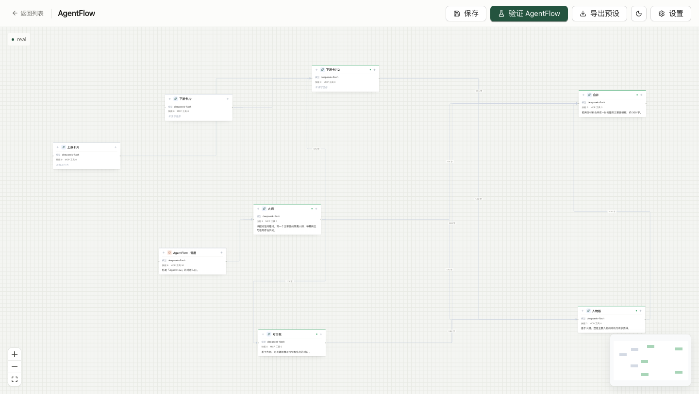
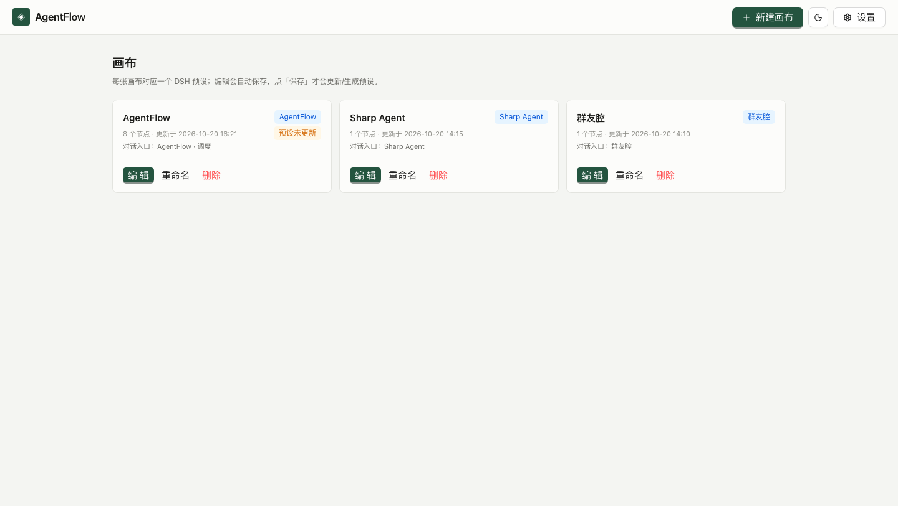
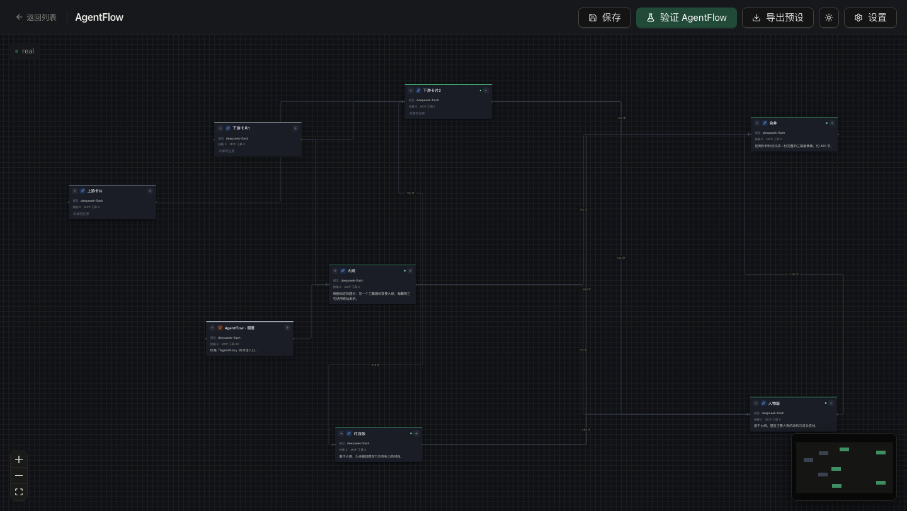

# AgentFlow · DSH 插件

> 在 DeepSeek Harness 里用**画布**编排 agent 工作流，一键生成 `/命令` —— 每一步由你定义，而不是塞进一个黑盒循环。

[](https://www.npmjs.com/package/dsh-plugin-agentflow)
[](./LICENSE)
[](https://github.com/deepseek-ai)



## 是什么

DSH 自带的 agent 是「一个模型 + 一堆工具」的循环，中间怎么想、调什么，你看不见也改不了。

AgentFlow 把它掰开：**画布上的每张卡片就是一个 agent 步骤**。你决定有几步、谁先谁后、谁并行、每步用哪个模型、能不能调 MCP 工具、做完怎么验收。编排好之后把整张画布生成成一个 DSH 命令，在对话里输入 `/命令名` 就能用。

- **节点**：LLM（调模型）/ MCP（直接调工具，不经过模型）/ 调度（根，对话入口）
- **执行**：纯 DAG，无上游先跑、同层并行、失败不阻塞其它分支
- **模型**：全部走 DSH 自己的模型通道（`ctx.llm`），推理强度和兜底模型可逐节点配
- **命令**：整张画布生成成 `/命令名`，插件热注册、即时生效，不写 DSH profile

## 安装

### 从 npm

DSH → 设置 → 插件 → 添加插件 → 输入：

```
dsh-plugin-agentflow
```

### 从 GitHub

```
CC19990113/dsh-plugin-agentflow
```

装完重启 DSH。左侧栏出现 **AgentFlow** 入口，后端由插件自动拉起（默认 `127.0.0.1:8791`），不需要手动跑命令。

要求：DSH 桌面版 0.2.x、Node 22+。

## 怎么用

### 1. 画布列表



每张画布可以生成一个 DSH 命令。卡片上会标出「对话入口」（哪张卡是和用户对话的根节点）。

### 2. 编排

- 拖卡片改位置，从卡片边缘拖线连上下游
- 点卡片改模型、推理强度、兜底模型、技能、MCP 工具
- 「加下游 / 加上游」快速派生新卡
- 编辑**自动保存**，点「保存」把编排落库；点「生成命令」把画布变成 `/命令`

### 3. 验证

顶栏「验证 AgentFlow」会真实跑一遍整张图（会消耗 token），用来看流程通不通。卡片上只显示配置摘要，不堆运行产出。

### 4. 生成命令

点画布上的「生成命令」（或插件页 → 添加插件 →「从 AgentFlow 画布生成命令」，或设置页 AgentFlow 分区），得到 `/agentflow-<slug>`：

- **生成即生效**：命令由插件热注册，无需重启 DSH，也不写 `~/.dsh/profiles/<profile>/cordis.patch.yml`
- **命令名**：默认 `agentflow-<画布 slug>`；同名会覆盖
- **落盘**：`<数据目录>/commands/<name>.json`，只存画布 id
- **跟当前画布**：画布内联打开哪张，设置页/菜单就生成哪张（画布会通过 `agentflow-board-active` 事件回传当前 id）；没有回传时才退回索引第一张

在对话输入框里：

| 输入 | 行为 |
|---|---|
| `/agentflow-<slug>` | 只看画布：返回画布名、节点列表（label / 任务 / 上游）与用法，不消耗 token |
| `/agentflow-<slug> 要做的事` | 进入该画布的工作流：你的话作为**入口节点（调度卡）的输入**，之后对话被画布 DAG 推着走 |
| `/agentflow-<slug> off` | 退出该画布的工作流 |

### 5. 输入命令之后，对话怎么走

不是「把画布说明塞给模型让它自觉」，而是插件按 DAG 推进：

1. 你的话进**根节点**（调度卡；优先认引擎的 `type: 'orchestrator'`），模型只做这个节点，做完必须调 `agentflow_node_done(node_id, output)`
2. 插件校验（非空、≥10 字、前置已完成、只有发起这次工作流的 agent 能标记），通过后算下一层
3. 这一层有几个节点，就**强制**为每个节点建一个 teammate：
   - teammate 名由插件分配：`<节点id清洗>-<本次 run 的随机后缀>`。Agent Teams 的 roster 名字**永不复用**（实测连 DSH 重启后都还记着），所以每次 run 都换后缀；同一 run 内清洗撞名再加 `-2`
   - `tools/pre-execute` 只放行这一套名字（报错里列出当前能派谁）
   - 派发指令里带每个节点的任务、验收标准、上游产出摘要
4. **非根节点必须先真的 spawn 过才能标完成**（`tools/post-execute` 观察到成功的 `spawn_teammate` 才算），所以模型没法自己把下游做完
5. 每个 teammate 回报后，用它的实际产出去调 `agentflow_node_done`；一层全部完成才进下一层
6. 全部完成 → 收束并给产出清单；连线成环 → 判定卡住并提示

画布上给节点配的**模型 / 推理档 / 技能 / 工具**会写进派发指令（`spawn_teammate` 没法指定模型，所以是「按这套配置干活」的提示，不是强制）；`type: mcp` 的节点在命令模式暂不执行，指令末尾会明确列出「本次不执行：…」，不会静默吞掉。

每一步都会注入一行进行态（已完成 / 已派发待回报 / 待派发）。模型想收工但还没派发时，`turn-stopping` 会在同一回合先催一次（同一个 turn 不重复刷），超过 120s 再补提醒。

同一张画布**已有进行中的工作流**时，再输入 `/命令 文本` 会被拒绝（提示先 `off` 或等结束），不会静默覆盖。

工作流状态会落到 `<数据目录>/runs/<会话>.json`：DSH 重启后能接着跑（恢复时会换新的 teammate 名重新派发，因为旧 teammate 已经不在）。`/命令 off` 除了退出，还会**中断已经派出去的 teammate**（需要装 Agent Teams；服务不在时只退出不中断）。

teammate 名撞车（概率极低）会自动换名重试一次，并提示模型用新名字重新 spawn。

指令有预算：规则永远先占位，用户输入/节点详情按剩余额度截断并提示「已截断」。没有任务（或只有空白）的占位节点自动跳过；整张画布没有可执行节点时直接判结束，不会留一个永远不动的 run。

> 前提：Agent Teams（`spawn_teammate` 等工具）要在 profile 里；没装时命令仍可用，只是派发那一层会停在对话里，由你手动推进。

### 6. 想跑多层 / 多节点：先调 teammate 名额

画布上**每个节点都会建一个 teammate**，所以节点多、层数深的画布会很快撞上限。默认上限不是代码里的 16，而是被 profile bundle 压到 **8**：

| 层 | 值 | 位置 |
|---|---|---|
| 主包默认 | `DEFAULT_MAX_MEMBERS = 16` | `@deepseek-ai/dsh-experimental-agent-team/lib/index.js` |
| bundle 覆写 | `maxMembers: 8` | `@deepseek-ai/dsh-experimental-agent-team-profile/cordis.patch.yml` |
| desktop profile | bundles 里挂了这个 bundle | `~/.dsh/profiles/desktop/package.json` |

要开大，在**自己的 profile** `cordis.patch.yml` 末尾追加同 id 覆写（`<profile>` 换成你的，桌面版是 `desktop`）：

```yaml
- id: agent-team
  config:
    maxMembers: 32
    maxTasks: 256
    maxMessageBytes: 65536
    disposalTimeoutMs: 5000
```

三个坑：

1. **config 是整体替换、不深合并**（`dsh-app-boot` 原文 "config is replaced wholesale, not deep-merged"）。只写 `maxMembers` 会把其余键打回 schema 默认，所以四个键必须写全（后三个与 bundle 原值一致）。
2. **必须重启 DSH**：`TeamService` 在构造时读 config，热改不生效。
3. **注意内存**：每个 teammate 都是独立 agent（自己的会话与上下文），十几个同时活着时内存和 token 都明显上涨；32 已接近 24 GB 机器的实际承受力。另外名额**用完不回收**——Agent Teams 的成员名永不复用，所以一次 App 会话里能建的 teammate 总数是有上限的，宽画布建议拆小或分层跑。

画布删掉时对应命令文件会被一起清掉（不再注册也不会留死文件）；配置 `commands: false` 可关掉注册（只生成不挂命令）。历史遗留的预设不再生成，插件设置页只留「旧预设清理」用于删除 profile 里的旧行。

## 深色模式



主题跟随 DSH：内联（`native`）模式下画布直接读宿主主题（`body[data-ds-dark-theme]` / `html.dark` / 系统偏好），切换时实时推送；`iframe` 回滚模式仍把主题拼进地址，画布启动时按它初始化。手动切换只在本次会话内生效，DSH 重开时重新读配置。

## 架构

```
DSH 桌面
├── 插件（index.js）
│   ├── 工具：agentflow_list / agentflow_run
│   ├── 客户端：侧边栏入口、设置页分区、主视图画布
│   │   ├── src/canvas   画布源码（构建时编进客户端 bundle）
│   │   └── src/host     宿主桥：API 基地址 / 主题 / 样式注入
│   └── 子进程：node runtime/server.mjs → 127.0.0.1:8791（只提供 API）
│       ├── engine.mjs   纯 DAG 执行器
│       ├── llm.mjs      调模型（只走 bridge）
│       └── web/dist     独立画布页面（iframe 回滚模式用）
└── llm bridge（lib/bridge.js）
    └── 把 ctx.llm 暴露给引擎，模型调用始终在 DSH 进程内
```

`runtime/` 是打包时从引擎仓库同步过来的副本（`npm run sync`），所以插件自带完整引擎，装完即用。画布源码（`src/canvas/`）由同一次同步带来、构建时一起编进客户端 bundle：默认 `native` 模式下画布直接长在 DSH 主视图里，8791 只负责 API；配成 `iframe` 则回滚到嵌入 `web/dist` 独立页面的旧行为。

## 配置

| 项 | 默认 | 说明 |
|---|---|---|
| 数据目录 | `~/.dsh/agent-flow-data` | 首次启动会自动从 `~/.dsh/agent-flow/data` 迁移 |
| 后端端口 | `8791` | 可用 `agentflowPort` 插件配置改 |
| 旧预设 profile | `desktop` | 读/删历史预设（`/api/presets`）用；可用环境变量 `AGENTFLOW_PROFILE` 指定别的 profile |
| `commands` | `true` | 是否把 `<数据目录>/commands/*.json` 注册成对话命令；关闭则只生成不注册 |
| `agentflowRenderMode` | `native` | 画布渲染方式：`native` 把画布编进客户端 bundle 直接渲染；`iframe` 回滚到嵌入独立画布页面 |
| `agentflowUrl` | `http://127.0.0.1:8791` | `native` 下作为 API 基地址；`iframe` 下作为画布页面地址 |
| `observe` | `true` | 观察器：只记每一步的消息形状与每次工具调用，不拦不改 |
| `observeDir` | `<数据目录>/observe` | 观察日志落盘目录 |

## 观察器

`observe` 打开时，插件挂在 `agent/pre-step`、`tools/post-execute`、`agent/turn-stopping` 三个钩子上，
把每个 agent 的一次对话记成 `<observeDir>/<session>.jsonl`，一行一个事件（工具耗时取自 `tools/execute` 的真实执行时间）：

| `t` | 字段 | 说明 |
|---|---|---|
| `step` | `turn` `step` `msgs[]` `decision{}` | 这一步进了哪些消息（只记 `source.kind` / `form` / 字符数，不存正文）、最终决策是 `enter` 还是 `reject` |
| `tool` | `turn` `step` `name` `args` `ms` `isError` `text` | 每一次工具调用；被 `pre-execute` deny 的也会出现，`isError` 为真 |
| `stop` | `turn` | 模型认为自己干完了（`turn-stopping`）的地方 |

用途：在做「强制工作流」之前，先看清模型实际怎么调工具、在哪收工、被拒之后怎么反应。
纪律：写盘 fire-and-forget，任何异常只 `warn`——观察器坏了不能连累对话。

## 限制

- **只在 macOS 上验证过**，Windows 的路径与命令未测
- teammate 名额默认 8（bundle 覆写），宽画布先按 §6 调大；名额用完不回收，重启 DSH 才重置
- 运行态是全局的：跑图时切换画布，事件会被丢弃；「停止」不分画布
- 验证跑图会真实调用模型，注意 token 消耗
- 命令只注册已存在的画布：画布删了，对应命令下次扫描时自动消失
- 宿主客户端运行时是 **React 18**；画布源码来自 React 19，但只使用两者共有的 API（不用 19-only API）
- 画布样式靠 `.af-canvas` 作用域隔离（Tailwind 的 `:root` 变量收进容器内），不污染宿主页面
- **`npm run sync` 会清空重建 `src/canvas/`**：为内联渲染做的适配改动会被引擎源码覆盖，改完需要重做

## 开发

```bash
npm run build   # 构建客户端 bundle（lib/client.js，含画布）
npm run sync    # 从 ~/.dsh/agent-flow 同步引擎到 runtime/，并把画布源码同步到 src/canvas/
npm run check   # 语法检查 + tsc --noEmit
npm test        # 插件自测（479 项：bridge 91 + client 86 + observe 28 + commands 150 + flow 124）
npm run observe # 把观察日志读成时间线（默认 ~/.dsh/agent-flow-data/observe）
```

引擎侧测试在 `~/.dsh/agent-flow/test`（72 项）。

## 发布

发布由 **GitHub Release 触发**，不在本地手动 `npm publish`：

1. 升 `package.json`（和 `package-lock.json`）的版本号
2. 打 tag 并创建 Release：`gh release create v0.3.0 --title "v0.3.0" --notes-file notes.md`
3. Release 发布后 [`.github/workflows/publish.yml`](.github/workflows/publish.yml) 自动执行：
   `npm ci` → 语法检查 → 构建客户端 → 自测（含客户端 bundle 自测）→ 校验提交的 `lib/client.js` 与源码构建一致 → 校验 tag 与 `package.json` 版本一致 → `npm publish --provenance`

需要仓库 secret `NPM_TOKEN`：npm granular token，权限选 `Read and write (publish and stage)`，并勾选 `Bypass two-factor authentication`。

## License

[MIT](./LICENSE)
